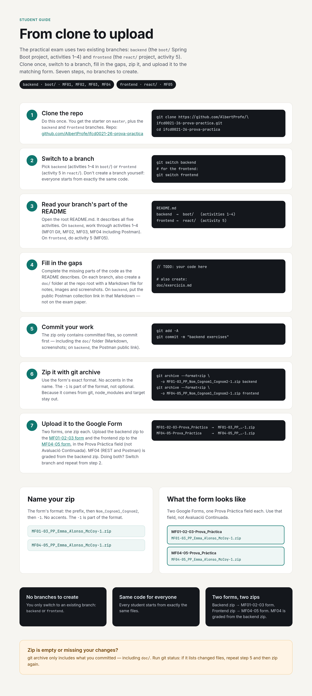

# Prova pràctica IFCD0021-26

Curs: **26/CIFO/FSE/809/0197720/075 — Fullstack Júnior web developer amb JAVA**

Data i horari: **27/11/2026, 08:30–12:30 (4 hores)**

Aquest repositori és l’esquelet de partida. No comenceu el projecte de zero. Cloneu-lo, treballeu a les branques indicades i lliureu els dos zips pels formularis de Google.

## Guia de l'alumne

Guia visual pas a pas, des de clonar el repositori fins a pujar els zips: [Student guide: From clone to upload](https://albertprofe.dev/images/ifcd0021-26/docs/student-guide/Main.dc.html)

[](https://albertprofe.dev/images/ifcd0021-26/docs/student-guide/Main.dc.html)

## Contingut del repositori

- `boot/` — projecte **Spring Boot** (Maven, Java 21, H2). És on feu les activitats 2, 3 i 4 (MF02, MF03 i MF04).
- `react/` — projecte **Vite + React**. És on feu l’activitat 5 (MF05).
- La branca `master` guarda només l’esquelet inicial. **No hi treballeu.**

El repositori ja té dues branques de treball, `backend` i `frontend`, creades a partir de l’esquelet.

## Com començar

```bash
git clone https://github.com/AlbertProfe/ifcd0021-26-prova-practica.git
cd ifcd0021-26-prova-practica
```

Per treballar el backend (activitats 2, 3 i 4):

```bash
git checkout backend
```

Per treballar el frontend (activitat 5):

```bash
git checkout frontend
```

Feu commits a cada branca amb els vostres canvis. Si en algun moment no veieu les branques, creeu-les vosaltres des de `master`:

```bash
git checkout master
git checkout -b backend
git checkout master
git checkout -b frontend
```

## Com executar l’esquelet

Backend:

```bash
cd boot
mvn spring-boot:run
```

L’API queda a `http://localhost:8080`. La consola H2, a `http://localhost:8080/h2-console`.

Frontend:

```bash
cd react
npm install
npm run dev
```

## Les 5 activitats

### Activitat 1 (MF01) — Git: branques i `git archive`

Treballeu a les branques `backend` i `frontend` (deixeu `master` amb l’esquelet). Abans de generar els zips, creeu a cada branca la carpeta `doc/` (vegeu més avall). Al final, des de l’arrel del repositori, genereu els dos zips amb el format dels formularis. Exemple (canvieu `Emma_Alonso_McCoy` pel vostre `Nom_Cognom1_Cognom2`, sense accents):

```bash
git archive --format=zip -o MF01-03_PP_Emma_Alonso_McCoy-1.zip backend
git archive --format=zip -o MF04-05_PP_Emma_Alonso_McCoy-1.zip frontend
```

El `-1` del final forma part del format del formulari. Si només teniu un cognom, useu `Nom_Cognom-1`.

**Pregunta (amb les vostres paraules):** Per què els equips fan servir branques en lloc de treballar tots a `main` (o `master`)?

### Activitat 2 (MF02) — Classes Java i servei

A `boot/`, creeu les classes `Teacher`, `Student` i `Enrollment`, i un servei amb lògica de negoci més enllà del CRUD. Exemples vàlids: no permetre una matrícula duplicada, un màxim d’estudiants per professor, o llistar els estudiants d’un professor.

**Pregunta (amb les vostres paraules):** Què fa una capa de servei que no fa un repositori CRUD? Doneu un exemple de lògica de negoci.

### Activitat 3 (MF03) — Entitats JPA i relacions

Convertiu les classes en entitats JPA. `Enrollment` ha de ser una `@Entity` pròpia, amb dos `@ManyToOne` (cap a `Teacher` i cap a `Student`) i un camp extra (assignatura, data o similar). Creeu els repositoris (`JpaRepository` n’hi ha prou; no calen consultes pròpies). Expliqueu per què feu servir una entitat `Enrollment` i no un `@ManyToMany` amb `@JoinTable`.

**Pregunta (amb les vostres paraules):** Expliqueu una relació `@OneToMany` amb un exemple d’una aplicació real.

### Activitat 4 (MF04) — API REST i Postman

Creeu el controlador REST i connecteu-lo al servei, amb endpoints per a les matrícules (enrollments). Proveu l’API amb Postman. Poseu l’**enllaç públic** de la col·lecció de Postman al fitxer Markdown de la carpeta `doc/` de la branca `backend` (juntament amb captures, si en teniu). No l’escriviu al full de la prova.

**Pregunta (amb les vostres paraules):** Què és el cicle de petició i resposta (*request/response*)? Expliqueu què passa des del client fins a la base de dades i tornada.

### Activitat 5 (MF05) — Component React

A `react/`, creeu un component que mostri l’array de matrícules importat de `react/src/data.js`. **No feu `fetch`** ni crideu l’API. Feu servir `useState` i un esdeveniment (per exemple, filtrar per professor o marcar una matrícula com a seleccionada).

**Pregunta (amb les vostres paraules):** Què és la immutabilitat a React, i per què no s’ha de canviar l’estat directament?

## Carpeta `doc/` a cada branca

A cada branca de treball (`backend` i `frontend`) heu de crear vosaltres una carpeta `doc/` a l’arrel del repositori, amb un fitxer Markdown (per exemple `doc/exercicis.md`) i les captures o imatges de les activitats. Aquesta carpeta no ve amb l’esquelet: creeu-la vosaltres.

- A la branca `backend`: notes i captures del backend (API, Postman, model) i, obligatòriament, l’enllaç públic de la col·lecció de Postman.
- A la branca `frontend`: notes i captures del component React.

No escriviu l’enllaç de Postman al full de la prova. Feu el commit de `doc/` a cada branca abans de generar els zips, perquè quedi dins de l’arxiu.

## Com lliurar el treball

Heu d’iniciar sessió amb un compte de Google. Feu servir els camps existents de **Prova Pràctica** de cada formulari (no canvieu el nom dels zips: han de seguir el format del camp):

1. **MF01-02-03:** https://forms.gle/rkAXo279ktYZcMC27  
   Al camp **MF01-02-03-Prova_Pràctica**, pugeu el zip de la branca `backend`, amb el nom  
   `MF01-03_PP_Nom_Cognom1_Cognom2-1.zip`  
   (exemple: `MF01-03_PP_Emma_Alonso_McCoy-1.zip`).

2. **MF04-05:** https://forms.gle/Tyf6cw2JsTZaZxb88  
   Al camp **MF04-05-Prova_Pràctica**, pugeu el zip de la branca `frontend`, amb el nom  
   `MF04-05_PP_Nom_Cognom1_Cognom2-1.zip`  
   (exemple: `MF04-05_PP_Emma_Alonso_McCoy-1.zip`).

El treball de l’activitat 4 (REST i Postman) és a la branca `backend` i, per tant, al zip `MF01-03_…`. L’enllaç de Postman va al Markdown de `doc/` d’aquesta branca, no al formulari ni al full.

No feu servir els camps d’**Avaluació Continuada** per pujar els zips d’aquesta prova.

Les respostes de les cinc preguntes obertes s’escriuen al **full de la prova**, amb les vostres paraules.

## Requisits tècnics

- JDK 21, Maven, Node.js i npm, Git, un IDE (IntelliJ, VS Code o Eclipse).
- Postman per provar l’API i publicar la col·lecció (activitat 4).
- Base de dades: H2 en memòria, ja configurada a l’esquelet.
